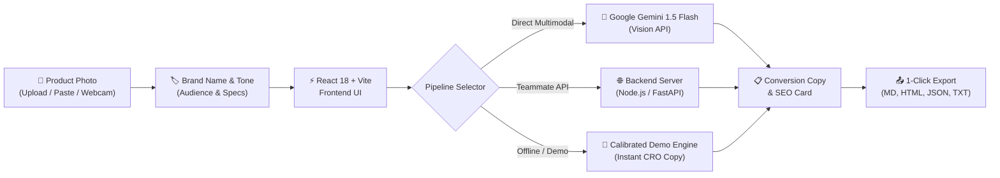

# AI Product Description Writer 🚀
### HackMatrix AI Studio | Smart Campus GenAI Hackathon

An intelligent, vision-powered e-commerce conversion copywriting platform that transforms raw product photos and brand positioning into detailed, persuasive, and high-converting product descriptions.

[](https://reactjs.org/)
[](https://vitejs.dev/)
[](https://tailwindcss.com/)
[](https://ai.google.dev/)
[](LICENSE)

---

## 📌 Problem Statement

Writing compelling product descriptions at scale is one of the biggest bottlenecks for online merchants and e-commerce brands:
- Standard manufacturer descriptions fail to hook visitors or articulate tangible benefits, leading to low conversion rates and abandoned carts.
- Small business sellers and solo entrepreneurs lack the budget to hire dedicated conversion copywriters and SEO specialists for every SKU.
- Writing copy manually takes 30–60 minutes per product.

**Product Description Writer** solves this by combining Google Gemini Multimodal Vision with proven e-commerce conversion copywriting frameworks (Problem-Agitation-Solution, Benefit-First Bullets, and SERP CTR optimization) to produce ready-to-publish copy in seconds.

---

## ✨ Key Features

### 1. Multimodal Vision Product Analysis
- **Drag-and-Drop / Clipboard / Webcam**: Upload product photos by dragging, browsing, pasting from clipboard (`Ctrl+V`), or taking a live photo with your camera.
- **Visual Attribute Extraction**: Gemini Vision identifies materials, textures, aesthetic style, form factor, and build quality directly from the image without requiring tedious manual specification entry.

### 2. High-Converting Copy Architecture
- **Hook & Tagline**: Punchy one-liners crafted for customer intrigue and brand recall.
- **Narrative Story**: Emotion-driven, customer-centric description built on the Problem-Agitation-Solution (PAS) framework.
- **Feature-to-Benefit Formula**: Automatically converts technical specs into tangible lifestyle outcomes (e.g., *"11mm Titanium Drivers — so you enjoy concert-hall acoustic fidelity without distortion"*).

### 3. SEO & Google SERP Snippet Preview
- Real-time **Google Search Result simulation** with live character length counters for Meta Titles (≤60 chars) and Meta Descriptions (≤160 chars).
- High-intent keyword suggestions to rank on search engines.

### 4. Marketplace & Social Media Channels
- Instant **Instagram Launch Captions** with relevant hashtags.
- **15-second TikTok / Reels Video Hook Scripts**.
- Formatted **Shopify & Amazon bullet specifications** ready for 1-click clipboard export.

### 5. Conversion Rate Optimization (CRO) & A/B Testing
- **Conversion Potential Scorecard**: Evaluates readability grade, urgency level, power word density, and estimated sales lift.
- **A/B Split-Testing Generator**: Compares Emotion-led copy (Variant A) against Feature-led copy (Variant B).

### 6. 1-Click Demo & Hackathon Presets
- Built-in sample products (Acoustic Earbuds, Artisan Ceramic Mug, Velocity Running Shoes, Ceremonial Matcha) so judges can test every feature instantly with zero setup.

---

## 🛠️ Architecture & Tech Stack



- **Frontend**: React 18, Vite 6, Tailwind CSS, Lucide Icons, Canvas Confetti
- **AI Integration**: Google Gemini 1.5 Flash Multimodal Vision
- **Backend Bridge**: Multipart `FormData` API contract compatible with Node.js and Python FastAPI
- **Export Formats**: Markdown (`.md`), HTML (`.html`), JSON (`.json`), Text (`.txt`)

---

## 🚀 Quick Start Guide

### Prerequisites
- Node.js (v18 or higher)
- npm (v9 or higher)

### Installation & Run

1. **Clone the repository:**
   ```bash
   git clone https://github.com/Joseph-mappila/CurioCET.git
   cd CurioCET
   ```

2. **Install dependencies:**
   ```bash
   npm install
   ```

3. **Start the local development server:**
   ```bash
   npm run dev
   ```
   Open [http://localhost:3000](http://localhost:3000) in your browser.

4. **(Optional) Configure Gemini API Key:**
   - Click **"API Config"** in the top navigation bar and enter your Google Gemini API key.
   - Alternatively, create a `.env` file from `.env.example`:
     ```env
     VITE_GEMINI_API_KEY=your_gemini_api_key_here
     ```
   *Note: If no API key is provided, the application runs in **Smart Demo Mode** with pre-calibrated realistic product outputs, ensuring seamless live judging!*

---

## 📡 Backend API Contract

If connecting your own backend, use this standard contract:

### `POST /api/generate`
**Content-Type**: `multipart/form-data`

**Request Body:**
| Field | Type | Description |
|---|---|---|
| `image` | File | The uploaded product image file (JPG, PNG, WEBP) |
| `brand_name` | String | Name of the brand (e.g. "NovaSound") |
| `tone` | String | Tone of voice (`persuasive`, `luxury`, `playful`, `professional`, etc.) |
| `audience` | String | Target demographic (e.g. `professionals`, `genz`, `athletes`) |
| `highlights` | String | Optional key features or specs |
| `keywords` | String | Optional target search keywords |

**Response Format:**
```json
{
  "title": "NovaSound Apex Wireless Noise-Cancelling Earbuds",
  "tagline": "Pure Acoustic Silence. Masterfully Engineered Sound.",
  "narrative": "Step into a personal sanctuary of pristine sound...",
  "benefits": [
    "Studio-Grade Acoustic Purity — Titanium drivers for crystal-clear fidelity.",
    "48dB Adaptive Noise Cancellation — Real-time isolation from background distractions."
  ],
  "seo": {
    "metaTitle": "NovaSound Apex | Premium Wireless Noise-Cancelling Earbuds",
    "metaDescription": "Experience studio-grade sound and 48dB active noise cancellation with NovaSound Apex.",
    "keywords": ["wireless earbuds", "noise cancelling headphones", "bluetooth 5.4"]
  },
  "social": {
    "instagram": "Say goodbye to background noise...",
    "tiktok": "Why is everyone obsessed with these?...",
    "shopifyBullet": "• Brand: NovaSound\n• Battery: 40h total"
  },
  "metrics": {
    "score": 96,
    "readability": "Grade 8 (Optimal for Sales)",
    "urgencyScore": "High",
    "powerWordsCount": 14,
    "conversionBoost": "+34% Estimated Lift"
  }
}
```

---

## 🎯 Target Evaluation Rubric Alignment

| Rubric Criteria | How We Deliver It |
|---|---|
| **Innovation & Creativity** | Combines multimodal computer vision with conversion copywriting psychology (PAS framework), dynamic tone adapting, and automatic A/B test split creation. |
| **Technical Execution** | Ultra-responsive React 18 architecture, sub-second HMR with Vite, drag-and-drop + webcam capture, direct browser-side Gemini Vision integration, and graceful offline fallback. |
| **Practical Impact** | Directly solves e-commerce cart abandonment and hours of manual cataloging. Produces complete exportable assets: Title, Story, Benefits, SEO SERP, Social, and Shopify specs. |

---

## 📄 License

This project is licensed under the MIT License - see the [LICENSE](LICENSE) file for details.